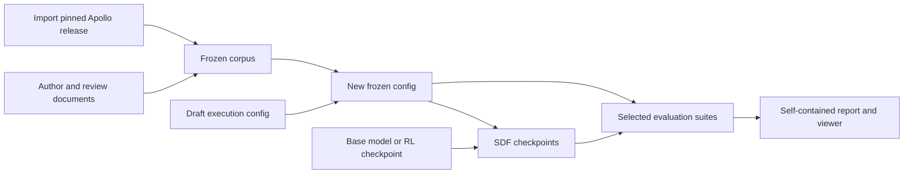

# Contrastive SDF exploration

Run supervised document finetuning (SDF) on a frozen corpus, evaluate starting models and SDF checkpoints, and inspect belief recall and coding style. The retained experiments are the 1,000-document hand-authored run and the Apollo Hugging Face corpus run.

## Start here

```bash
uv sync --extra analysis --group dev
uv run contrastive-sdf --help
# For Tinker execution, export TINKER_API_KEY or use uv run --env-file .env ...
```

| Task | Entry point | Inputs |
| --- | --- | --- |
| Review completed Apollo run | `contrastive-sdf audit --run logs/comprehension/huggingface-sdf-v1` | Its immutable `contract.yaml`, corpus, checkpoints and raw logs |
| Review completed hand-authored run | `contrastive-sdf audit --run logs/comprehension/atomic-sdf-1000-steps-v1` | Its immutable `contract.yaml` and sealed 1,000-document exports |
| Prepare Apollo corpus and freeze a new config | `contrastive-sdf freeze --config configs/runs/apollo.yaml --output configs/frozen/my-run.yaml` | Pinned release; draft stays unchanged |
| Check a frozen config | `contrastive-sdf validate --config configs/frozen/my-run.yaml` | Checks corpus, task banks, sampling settings and blockers; no model calls |
| Train and evaluate | `contrastive-sdf run --config configs/frozen/my-run.yaml` | Explicitly authorized model execution; resumable checkpoints |
| Rebuild a viewer | `contrastive-sdf report --run logs/comprehension/my-run` | Saved contract, not the current draft |
| Generate hand-authored documents | `contrastive-sdf generate --help` | Separate generation recipe; paid stages require `--execute` |
| Evaluate an API-hosted model | `contrastive-sdf eval inspect --help` | Named suite, frozen config, explicit target and new log directory |

Edit the experiment ID and output directory in a **copy** of a run profile before starting a fresh experiment. Existing runs refuse changed execution contracts. Freezing pins inputs; it does **not** approve task banks or scientific decisions.



New run profiles use the canonical explicit-authority belief prompts, pinned by manifest hash. Historical runs retain their original prompts. See [canonical belief evaluation and offline prompt review](docs/evaluations.md#canonical-belief-recall) for rerunnable configuration and commands.

## Browse the evaluation-awareness benchmark

Download the pinned, original Needham et al. benchmark and build a searchable,
offline viewer (requires your own Hugging Face dataset access):

```bash
uv run hf auth login
uv run contrastive-sdf benchmark setup
```

Open `data/benchmarks/eval-awareness/viewer.html`. Re-running setup verifies and
reuses the local snapshot. See [setup, viewer and provenance guide](docs/eval_awareness.md).
The data and viewer stay local because the benchmark includes gated GAIA content.

## Read SDF results

```bash
open logs/comprehension/huggingface-sdf-v1/reports/viewer.html
```

The viewer embeds all responses and runs without a server. It includes recall by authority, question direction and format; answer-order consistency; coding categories and paired A − B contrasts; response search; and exact execution provenance. JSON, JSONL, CSV, PNG and SVG exports sit beside it. Scores measure the configured belief readouts and AST coding style; the coding suite does not execute functional tests.

## Code map

| Package | Responsibility |
| --- | --- |
| `config/` | Strict execution schema, immutable input freezing, archived-contract replay |
| `corpora/apollo.py` | Byte-preserving import of the four released Apollo configurations |
| `corpora/hand_generated.py` | Verify sealed hand-authored exports |
| `corpora/generation/` | Live authoring stages, context review, cached generation provenance, QA and selection |
| `training/` | Document boundaries/order, token accounting, Tinker and GPU-local HF backends |
| `evals/suites/` | Coding and belief task construction |
| `evals/extensions.py` | Custom suite factories and strict raw-score collection |
| `evals/reports/` | Metric computation and shared viewer assets |
| `workflows/` | Run orchestration, execution receipts, budgets and completed-run audit |

See [configuration and GPU workflow](docs/workflows.md), [generation](docs/generation.md), [evaluation extensions](docs/evaluations.md), and [iteration scoring](docs/iteration_scoring.md).

## Local artifacts and provenance

`logs/`, `models/`, `data/comprehension/` and the hand-authoring response cache are ignored. Configs, prompt templates, canonical evaluation banks and source audits are tracked. Runs retain exact YAML bytes, corpus/sample identities, model/provider/revisions, seeds, tokenizer/order hashes, optimizer state, source archives, raw Inspect logs and cost receipts. Version 2 contracts are read only for historical replay; new execution configs use version 3.

The retained run artifacts are local: cloning Git alone does not restore their logs or the hand-authoring cache. Copy those immutable directories from the research artifact backup; Apollo input files can be downloaded at their pinned release revision. Retired workspace files are recoverable from `/private/tmp/contrastive-sfd-maintenance-20261014/retired` until that temporary backup is deliberately removed.

## Development

```bash
uv run ruff check src tests
uv run ruff format --check src tests
uv run pyright
uv run python -m unittest discover -s tests -t .
```

Static checks use the project configuration. GPU integration requires a separately provisioned host; local invariant tests use small CPU fixtures and make no paid model calls.
