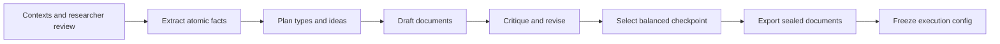

# Hand-authored corpus generation

The live generator and the frozen 1,000-document corpus are both retained. They have separate roles:

| Input | Role |
| --- | --- |
| `configs/generation/hand-authored-v5.yaml` | Existing authoring recipe; no SDF optimizer or evaluation sampling fields |
| `templates/corpus_generation/` | Exact stage instructions and generator suffix |
| `templates/universe_contexts/gpt-oss/` | Tracked context rendering inputs |
| `data/generation/hand-authored-v5/` | Ignored live response cache, source imports, reviews, attempts and generation provenance |
| `data/generation/short-python-overlap.jsonl` | Original 36-task diagnostic bank used by the recipe; not the active 144-task evaluation bank |
| `data/comprehension/atomic-sdf-1000-checkpoint-v5/checkpoint_exports/` | Sealed documents and generation QA used by the retained training run |

The recipe's original horizon is 2,400 documents, with checkpoints at 1,000, 1,700 and 2,400. The retained experiment used the 1,000-document checkpoint. Keeping that horizon preserves the historical type/idea allocation; this cleanup does not select a new corpus condition.

## Stage responsibilities



`generation/pipeline.py` coordinates these modules:

- `review.py`: context rendering, review decisions, durable model requests.
- `authoring.py`: fact extraction, planning, drafts and semantic critique.
- `integrity.py`: original request/model/seed/response lineage and explicit code revalidation.
- `selection.py`, `expansion.py`, `quality.py`: eligibility, balanced selection, checkpoint exports and diagnostics.
- `reuse.py`: immutable source imports required to resume the existing recipe.

Failed attempts remain in the **ignored cache** so resume and actual costs remain recoverable. They are never evaluation inputs. Researcher review remains hash-bound and separate from generation; preview mode permits authoring without granting corpus approval.

## Resume the retained recipe

```bash
uv run contrastive-sdf generate --recipe configs/generation/hand-authored-v5.yaml --stage contexts --dry-run
# After implementation changes, inspect a free audit of completed cached documents:
uv run contrastive-sdf generate --recipe configs/generation/hand-authored-v5.yaml --stage revalidate --reviewed-only --dry-run
# Record compatibility only after the audit succeeds; this makes no model calls:
uv run contrastive-sdf generate --recipe configs/generation/hand-authored-v5.yaml --stage revalidate --reviewed-only
```

Revalidation preserves original generation identity, text and model responses. Existing rejected candidates remain rejected; no quality check is waived. `--reviewed-only` audits completed cached documents and prevents filling unfinished candidates. Authoring stages require `--execute` for new model calls; none were run during cleanup.

To export the existing reviewed checkpoint into a new directory:

```bash
uv run contrastive-sdf generate --recipe configs/generation/hand-authored-v5.yaml --stage export --through-checkpoint 1000 --output /tmp/hand-export-1000
```

Point a **copy** of the hand-authored execution draft at a new frozen corpus directory, and pass the exports with `freeze --source /tmp/hand-export-1000`. Training never regenerates corpus text.

The live recipe depends on its imported source cache and code archives. Restore the whole ignored workspace from the artifact backup to resume it on another machine. A new recipe requires a new directory/version and researcher-defined context, models, quotas and reviews. Historical paths inside sealed source metadata are retained as provenance; actual current context-template IO resolves to the tracked template directory.
