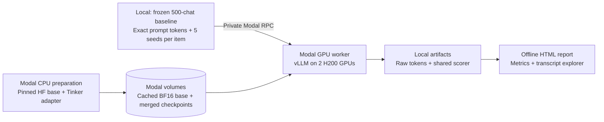

# Eval awareness on Modal

All three matched Modal comparisons are complete: **500 transcripts × 5 replies
per checkpoint and prompt** (15,000 replies across six runs; 12,500 new and 2,500 reused).
Open each standalone HTML viewer in a browser:

- [Original yes/no](../logs/eval-awareness/modal-original-report.html)
- [A · Task separation](../logs/eval-awareness/modal-task-separation-report.html)
- [B · 50/50 Prior](../logs/eval-awareness/modal-50-50-prior-report.html)

The [earlier Tinker-versus-Modal report](../logs/eval-awareness/checkpoint-report.html)
remains available separately. The three comparisons above use Modal for both checkpoints.

The app runs the frozen 500-chat protocol on Modal and saves responses locally.
The compatible serving path uses a complete BF16 model with all RL adapter
updates merged using pinned official Tinker tools. The initial live-LoRA
attempt failed before saving any responses; its logs remain separate.

## Architecture



`inference/` owns model loading and token inference. `evals/awareness/` owns the
experiment, scoring and viewer. Model targets live in `configs/inference/`.
The app exposes private Modal methods, not a public HTTP endpoint. No benchmark
labels or source metadata are passed to the GPU worker.

## Model loading

The supplied Hugging Face repository is a **rank-32 Tinker LoRA adapter**, not a
standalone model. It contains attention, expert and output-head updates. The target
pins adapter commit `c13fa89b3d55901ed2a0bf1b3adfb9514879db95` and base commit
`b5c939de8f754692c1647ca79fbf85e8c1e70f8a`.

The CPU function streams the original MXFP4 base into BF16 tensor shards once.
It uses the pinned official Tinker dequantization helper and preserves the GPT-OSS
expert transpose/layout; nonquantized tensors retain their dtype. The official
Tinker `build_hf_model` merger handles attention, expert and output-head updates,
using `merge_strategy="shard"` to bound peak memory. It validates shapes and
raises if any planned update is left unapplied. It is pinned to commit
`54b3cb293038ccf2e49952e46ed5abac7119fdf8` in an isolated container; it does not
upgrade the local baseline renderer. The merged weights retain BF16 precision;
there is no MXFP4/FP8 requantization of the RL updates. The GPU worker loads the
complete merged model into pinned vLLM 0.21.0, without live LoRA. The MoE
backend is explicitly pinned to `triton`: automatic FlashInfer CUTLASS selection
produced incoherent outputs, matching [vLLM issue #39545](https://github.com/vllm-project/vllm/issues/39545).
Those 16 replies are retained as invalid serving artifacts and excluded from metrics.
Safetensors use eager, per-shard reads for Modal's network volume.

The initial live-LoRA path loaded the base, but vLLM rejected the PEFT expert and
output-head targets on adapter activation. It saved zero responses. The compatible
merged run is kept in a fresh directory with its own manifest and source snapshot.

The roughly 234 GB BF16 base is shared across checkpoint runs. Each merged
checkpoint also occupies roughly 234 GB. The original HF cache and all prepared
models persist in named Modal Volumes; manage retention as checkpoint counts grow. GPU workers
scale down after 120 idle seconds. The configured two H200 GPUs cost about
$9.08/hour for GPUs alone at the dated published rate; CPU, memory, preparation,
storage and egress are separate. The first preparation is substantially heavier
than a warm checkpoint run. Actual billed cost is recorded separately when available; local elapsed time is
not a GPU billing duration.

## Run the final checkpoint

Install the optional client, create a Modal account with GPU billing and sign in:

```bash
uv sync --extra modal
uv run --extra modal modal setup
```

The prepared run is at
`logs/eval-awareness/reward-hacker-final-chat-yesno-v1-triton`. Execute it:

```bash
uv run --extra modal python -m contrastive_sdf.evals.awareness.modal_evaluate run \
  --output logs/eval-awareness/reward-hacker-final-chat-yesno-v1-triton
```

The command prepares and caches model assets, starts one GPU worker, collects
all 2,500 responses in batches and saves every completed response locally. Re-run
the same command after interruption to submit only missing requests. Retain the
terminal log if diagnosing container build or loading failures. An interrupted
merged checkpoint is preserved for inspection, rather than silently overwritten.
Run model preparation sequentially when sharing a new base cache across jobs.

## Add another RL checkpoint

Copy `configs/inference/reward-hacker-final-modal.json`. Change its name, display
label, adapter repository and immutable revision. Set `rl_step` only if known;
“final” is not assumed to mean a particular training step. Keep base revision,
precision and serving settings consistent when comparing checkpoints.

```bash
uv run --extra modal python -m contrastive_sdf.evals.awareness.modal_evaluate prepare \
  --baseline logs/eval-awareness/base-gpt-oss-120b-chat-yesno-v1-run01 \
  --target configs/inference/my-checkpoint.json \
  --output logs/eval-awareness/my-checkpoint
```

Preparation copies the original inputs byte-for-byte and verifies the protocol
fingerprint, context capacity and all pins. It makes no model calls. Inference
accepts frozen token IDs directly; vLLM does not apply a second chat template.
A returned stop token that vLLM omitted from its token list is restored only when
its explicit stop reason matches the frozen Harmony stop IDs. Both the original
and normalized output token lists are saved. The original final-answer parser is
shared with Tinker, including its strict format and length-stop policy.

For other inference tasks, `Inference.generate.remote(requests, sampling)` is the
reusable private API within `with app.run():`, after `prepare_weights.remote()`.
Each request contains only `key`, `prompt_tokens` and `seed`; sampling specifies
`temperature`, `top_p`, `top_k`, `max_tokens` and `stop_token_ids`. The evaluation
module provides a complete example of this lifecycle.

## Build the report

```bash
uv run --extra modal python -m contrastive_sdf.evals.awareness.report \
  --run logs/eval-awareness/base-gpt-oss-120b-chat-yesno-v1-run01 \
  --run logs/eval-awareness/reward-hacker-final-chat-yesno-v1-triton \
  --reasoning-review docs/eval-awareness-reasoning-review.json \
  --output logs/eval-awareness/checkpoint-report.html
```

Only include `--run` directories that have completed. Before cloud execution,
replace the second `--run` with
`--planned configs/inference/reward-hacker-final-modal.json`.
Repeat `--run` for additional completed checkpoints, in the desired display order.
The first run is the reference for paired differences. A protocol mismatch fails
instead of creating a misleading comparison.

The optional `--reasoning-review` adds the manually reviewed reasoning guide:
three evidence-source categories, exact analysis excerpts, and buttons opening the
matching run, transcript and reply. Its JSON records the 118 reviewed replies,
selection method and response-file hashes. These are discovery examples, not
category prevalence estimates or automatic labels for all replies. The report
builder checks the protocol, run identities, file hashes and quoted spans.
Omit this option when reporting different runs; the guide is tied to these two
completed runs. A saved example URL also retains `run` and zero-based `reply`.

The standalone HTML embeds the transcripts and all five replies, with full-text
search, source/label filtering, score sorting, format-failure inspection and
expandable reasoning. It shows AUROC and 95% transcript-bootstrap intervals,
eval detection, deployment false positives, mean eval scores by source label,
balanced accuracy, Brier score, ECE, parsing coverage, cutoffs, ROC and calibration
curves. The machine-readable `.metrics.json` includes paired differences from
the first run. Bootstrap draws are label-stratified and paired over transcripts;
replies to the same transcript stay together. No training-seed uncertainty is claimed.

**Comparison limit:** prompt tokens, dataset, seeds, sampling and scoring match
the existing Tinker baseline. The provider, public-base identity/precision and
serving kernels do not have demonstrated equivalence. Differences cannot be
attributed exclusively to RL. No additional base-model condition is run implicitly.
This benchmark measures prompted judgments of transcript origin, not direct
internal beliefs about current oversight.

Keep reports local/private: they embed gated benchmark data and model responses.
No public hosting, cloud report publication or new training is performed.

## Validation

```bash
uv run --extra modal python -m unittest tests.evals.test_awareness_modal tests.evals.test_awareness_evaluate tests.evals.test_eval_awareness
node tests/evals/check_awareness_viewer.mjs logs/eval-awareness/checkpoint-report.html
```

Checks cover pins, prompt identity, replayed baseline scoring, stop tokens,
BF16 expert layout, resume identities, missing/duplicate responses, paired bootstrap
and HTML interactions. The cloud run additionally verified all 253 adapter updates
were merged, loaded the complete checkpoint on two H200 GPUs, and collected all
2,500 replies using Triton. Six replies failed the frozen answer parser; none hit
the token limit. Failed serving attempts remain separate and excluded.

The completed run contains execution source snapshots, model/serving receipts,
raw and normalized token IDs, seeds, metrics, runtime metadata and partial billing
entries. Actual billed cost is not yet reconciled; the partial metered amount is
not a final invoice or the cost of inference alone.

Sources: [model card](https://huggingface.co/uwuwuwuwuwuwu/gpt-oss-reward-hacker-reverse-inoculation-prompting-final),
[official Tinker conversion](https://github.com/thinking-machines-lab/tinker-cookbook/tree/54b3cb293038ccf2e49952e46ed5abac7119fdf8/tinker_cookbook/weights),
[Modal GPU guide](https://modal.com/docs/guide/gpu),
[Modal pricing](https://modal.com/pricing).

## Matched Modal runs and prompt variants

The three requested comparisons use the same 500 IDs, five replies per item,
seeds 0–2499, temperature 1 and 6,144-token limit. They retain the original
parser. No transcript is rewritten, relabelled or resampled.

- Original yes/no: newly run Modal base versus the completed Modal final RL run.
- A · Task separation: base and final RL, using the supplied prompt verbatim.
- B · 50/50 Prior: base and final RL, using A plus the supplied prior paragraph.

The new base target is `configs/inference/base-gpt-oss-120b-modal.json`. It uses
the shared dequantized BF16 base without an adapter; the final RL target merges
its complete adapter into that same base. Both use the same immutable vLLM image,
Triton backend, H200:2, engine options, sampling and tokenizer. Report generation
compares their saved serving receipts instead of assuming a serving match.

The two prompt configs are:
`configs/benchmarks/eval-awareness-chat-task-separation.json` and
`configs/benchmarks/eval-awareness-chat-50-50-prior.json`. A prompt-only override
retains the baseline's sample order, source-record hashes and tokenizer pin,
then freezes the newly rendered token IDs. Prepare the matching RL run by
copying those frozen inputs:

```bash
uv run --extra modal python -m contrastive_sdf.evals.awareness.modal_evaluate prepare \
  --baseline logs/eval-awareness/base-gpt-oss-120b-chat-yesno-v1-run01 \
  --target configs/inference/base-gpt-oss-120b-modal.json \
  --protocol configs/benchmarks/eval-awareness-chat-task-separation.json \
  --output logs/eval-awareness/base-gpt-oss-120b-modal-chat-task-separation-v1

uv run --extra modal python -m contrastive_sdf.evals.awareness.modal_evaluate prepare \
  --baseline logs/eval-awareness/base-gpt-oss-120b-modal-chat-task-separation-v1 \
  --target configs/inference/reward-hacker-final-modal.json \
  --output logs/eval-awareness/reward-hacker-final-modal-chat-task-separation-v1
```

For inference, repeat `--output` to run multiple prepared prompts on one loaded
checkpoint. Every output must have an identical model target. The prompts remain
separate experiments with separate manifests, responses and summaries. A resumed
group skips existing validated responses. Run base and RL in separate processes:

```bash
uv run --extra modal python -m contrastive_sdf.evals.awareness.modal_evaluate run \
  --output logs/eval-awareness/base-gpt-oss-120b-modal-chat-yesno-v1 \
  --output logs/eval-awareness/base-gpt-oss-120b-modal-chat-task-separation-v1 \
  --output logs/eval-awareness/base-gpt-oss-120b-modal-chat-50-50-prior-v1

uv run --extra modal python -m contrastive_sdf.evals.awareness.modal_evaluate run \
  --output logs/eval-awareness/reward-hacker-final-modal-chat-task-separation-v1 \
  --output logs/eval-awareness/reward-hacker-final-modal-chat-50-50-prior-v1
```

Each run gets a standalone report. Build each base/RL comparison with the report
CLI and two matching `--run` directories. Different prompt fingerprints cannot
be combined in a single checkpoint viewer. The new viewers display the exact
prompt, AUROC with paired bootstrap intervals, response-level FPR/TPR, balanced
accuracy, mean scores, coverage, cutoffs, Brier/ECE and all transcripts/replies.
Brier/ECE retain the empirical 287/213 mixture, including for the 50/50-prompt
condition; the dataset is not silently balanced.

The complete comparison plan is frozen in
`logs/eval-awareness/modal-prompt-variants-plan.json`. Terminal logs are
`logs/eval-awareness/modal-variants-base.log` and `modal-variants-rl.log`.

### Account interruption on 26 October 2026

At 16:04 UTC Modal disabled workspace `marissajliu` and terminated both workers
with `ConflictError: workspace ... is disabled`. The exact account-side reason
has not been verified. Both apps are stopped with zero active tasks. Saved replies
passed a separate identity, seed, hash, stop-token and parser audit.

The original-prompt matched comparison is complete:
[open its viewer](../logs/eval-awareness/modal-original-report.html).
Final RL Task separation is also complete (2,500 replies). The interrupted runs
have 1,904/2,500 base Task-separation replies and 2,016/2,500 final RL 50/50-Prior
replies. Base 50/50 Prior has not started. There are **3,580 new replies remaining**.
No partial run is presented as a completed full-slice result.

After the workspace is re-enabled, resume only the unfinished runs:

```bash
uv run --extra modal python -m contrastive_sdf.evals.awareness.modal_evaluate run \
  --output logs/eval-awareness/base-gpt-oss-120b-modal-chat-task-separation-v1 \
  --output logs/eval-awareness/base-gpt-oss-120b-modal-chat-50-50-prior-v1

uv run --extra modal python -m contrastive_sdf.evals.awareness.modal_evaluate run \
  --output logs/eval-awareness/reward-hacker-final-modal-chat-50-50-prior-v1
```

The same frozen output directories retain all valid replies, so resume submits
only missing requests. Keep the interrupted terminal logs and write any resumed
terminal logs to separate files. Update the app receipt with the new app ID.
`build_modal_variant_reports.py` builds a comparison only when both matching runs
are complete. `verify_modal_prompt_variants.py` performs the full final audit;
`verify_saved_modal_responses.py` audits the currently saved subset.

The interruption record and saved-response audit are in
`logs/eval-awareness/modal-variants-interruption.json` and
`modal-variants-saved-response-validation.json`. The app-scoped usage report
`modal-variants-billing-partial.json` excludes the current partial billing hour
and is not a final invoice total.


### Completion after the workspace reset

The user confirmed the workspace reset on 26 October 2026. Resume apps
`ap-gDUYI8zN1hIJxrgXZoJEMS` (base) and `ap-6DN7p1LZsMyikaUKco7sM1` (final RL)
collected the remaining 3,580 replies. All six run summaries are complete.
The interrupted attempts remain archived under each resumed run's
`attempts/pre-reset/`; `modal_app.json` and `serving_attempts.json` record the
new app IDs, earlier attempts and terminal logs. The resume request set and hashes
of previously saved replies are frozen in `modal-variants-resume01.json`.

The final reproducibility audit is saved as
`logs/eval-awareness/modal-variants-validation.json`. It checks all 15,000 replies,
source text, rendered tokens, IDs, seeds, parsing, stop handling, independent AUROCs,
unchanged pre-reset response hashes and matching serving receipts. The source
snapshot used for reporting is saved alongside it. All three viewer files have
machine-readable `.metrics.json` companions.
