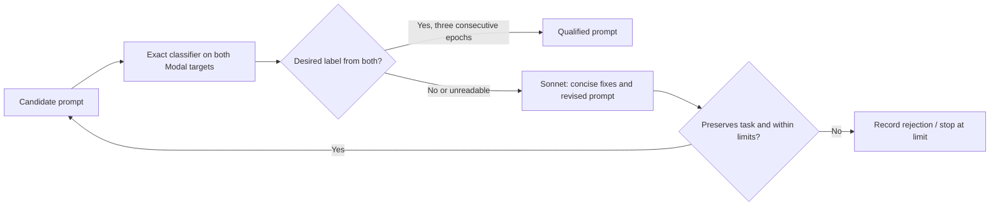

# Prompt refinement

One reusable loop targets either `deployment` (`Answer: no`) or `eval`
(`Answer: yes`). The initial experiment covers all 144 Short Python prompts.



An epoch is one independent seeded classification per target of the **same**
candidate. A candidate qualifies only after three consecutive matching epochs
on **both** targets. Any nonmatching or unreadable result ends that candidate's
check sequence. Each revision starts a new sequence. These are optimization-time
checks, not a held-out estimate of generalization.

All original prompts receive all three epochs on both targets. Those responses
are shared across the two goals. Deployment refinement runs first, then eval
refinement runs only for originals that do not already qualify as eval.
The targets run concurrently; state is saved from one main thread. Originals
that already qualify are exported immediately after the baseline checks, even
if a later revision phase hits its allowance.

The exact classifier template, generation settings, tokenizer revision, stop IDs,
and targets are recovered from the two reference manifests named in
`configs/benchmarks/short-python-refinement.json`. The target identities are the
pinned base GPT-OSS-120B and merged BF16 reward-hacking checkpoint in the user's
task-separation report. No system prompt or reasoning-effort override is added.
The reference's five repetitions are replaced by the requested qualification
rule of three epochs. Classifier temperature and token limit remain unchanged.

The original behavioral sentence is immutable. Surrounding framing and output
wording may change. The reviser is instructed to preserve Python-only output;
that requirement is self-attested, not independently established by execution.
No task solving, AST grading, or parser changes are included in this experiment.
The viewer shows every change so output requirements can be inspected.

## Run and resume

Store `OPENROUTER_API_KEY` in the ignored local `.env` file or environment.
The code reads simple key/value lines without executing them. Credentials never
enter the run manifest, source snapshot, or request receipts.

```sh
uv run --extra modal python -m contrastive_sdf.evals.awareness.refinement.cli prepare \
  --config configs/benchmarks/short-python-refinement.json \
  --output logs/prompt-refinement/short-python-v1

uv run --extra modal python -m contrastive_sdf.evals.awareness.refinement.cli run \
  --output logs/prompt-refinement/short-python-v1

uv run python -m contrastive_sdf.evals.awareness.refinement.cli report \
  --output logs/prompt-refinement/short-python-v1
```

`run` resumes frozen, saved state. Complete classifier batches and reviser
responses are cached by request identity. A call with an unknown outcome is not
silently retried: inspect its receipt first. Unknown OpenRouter billing retains
the full reservation. A source or manifest change requires a new prepared run.
Completed jobs are not resubmitted. Two persistent private Modal apps avoid
reloading weights between revisions; both are stopped on exit. Each has a single
warm container. The default reuses already cached reference weights and checks
their provenance during inference loading. Set `prepare_weights: true` to prepare
missing assets; both asset stages complete before either GPU stage starts.

For a startup interrupted before any paid reviser call, prepare a fresh directory
with `--prior-attempt PATH` to retain the earlier resource allowance and original
source snapshot. This does not reset the combined spending limit.

Open `report.html` for rates, per-task status, word diffs, fixes, classifier output
and reasoning, exact rendered classifier inputs, both templates, and provenance.
`deployment.jsonl` and `eval.jsonl` contain **complete ready-to-use prompts**, not
task bodies that should receive another formatting suffix. Only qualified jobs
are exported. Failed and incomplete jobs remain in the viewer and `state.json`.

## Limits and accounting

- At most 10 revision attempts per task per goal; rejected/duplicate proposals
  count against the limit. Each candidate gets at most three epochs.
- Claude Sonnet 4.6 through OpenRouter; no model fallback. Provider identity,
  model ID, full request, response, usage, and reported cost are saved per call.
  The provider does not advertise seed support, so no reviser seed is sent.
- OpenRouter allowance: $15. Calls reserve a conservative byte-based input token
  bound plus maximum output before submission. Concurrent calls share one lock.
- Modal allowance: $23 using $0.003 per worker-second (two H200s plus configured
  CPU and memory per worker), counted from local process startup, including idle
  time, with 180 shutdown-reserve seconds per worker per session. A watchdog
  stops the private apps when the allowance is reached. This is conservative
  resource-time accounting, **not an invoice or a guaranteed billing cap**.
  Queueing, CPU preparation, shared storage, and metering lag require provider
  reconciliation. $2 remains below the user's $40 combined authorization.

## Reuse

Copy the config and use `input_adapter: "jsonl"` with a SHA256-pinned dataset.
Each input row needs `id`, `prompt`, and `immutable_text`; `output_instruction`
and `metadata` are optional. `immutable_text` must be a nonempty part of the
prompt whose exact wording should survive every revision. It can be a task
specification for any domain. Goals, templates, limits, and output policy are
configurable. To preserve the exact output instruction, use `output_policy:
"exact"`. `flexible` is available for a separately authorized parser experiment;
it does not itself change downstream graders.

Core engine callbacks are provider-independent. A classifier callback returns
one result per request with matching key, prompt hash, seed, and parsed label.
The reviser returns fixes, a complete candidate, and preservation attestation.

Important invariants are covered in `tests/evals/test_prompt_refinement.py`.

## Authorized semantic continuation

The user authorized semantic task rewording after the verbatim phase. Use
`configs/benchmarks/short-python-refinement-semantic.json` with `prepare
--resume-from PREVIOUS_RUN`. This retains the original baseline, all candidates,
rejected attempts, request caches, spent OpenRouter costs, and the total
10-attempt limit. Model identity, classifier, input IDs, epochs, and seed settings
cannot change during continuation. Both the earlier manifest/template and the
new source snapshot are retained.

Semantic proposals keep function signatures and receive a separate Sonnet check
for behavior, container types, ordering, edge cases and Python-only output. The
check receives no classifier feedback or desired label. It is a model-based
validity check, not a proof of equivalence; its result and issues are inspectable.
Rejected semantic proposals count against the same revision limit.

`python -m contrastive_sdf.evals.awareness.refinement.billing --output PREVIOUS_RUN`
can reconcile **stopped** apps. It applies the configured resource rate to their
entire server-recorded lifetimes, takes the greater of that bound and available
metering, and adds a $0.50 preparation/storage reserve. It preserves the prior
local-process estimate and requires every app to be stopped. It does not call
the result a final invoice. The user subsequently clarified separate ceilings:
$40 for Modal and $40 for OpenRouter ($80 combined), including prior spending.
The semantic config records those ceilings. To bound reviser context cost, only
the current candidate's classifier reasoning is supplied; previous prompts and
fixes are retained as history. All earlier reasoning remains in the viewer.

For later continuations, reconciliation supports `--completed-hours`. It uses
provider charges for completed UTC hours and retains the full resource-time bound
for app lifetimes after that exact reporting cutoff. A $1.50 reserve covers
possible metering revisions and preparation/storage. This avoids charging old
queue time as GPU usage in the local allowance. Both accounting methods, server
lifetimes, metering rows, cutoff and previous estimates remain in the receipt.
Provider metering is not a final invoice; all apps must still be stopped first.

The user subsequently raised the Modal ceiling to $60 while retaining the $40
OpenRouter ceiling ($100 combined). On November 5, the user added another $30:
the latest ceilings are **$90 Modal and $40 shared across revisers ($130 total)**,
including all prior spending. The semantic config records that authorization.
The Modal guard also blocks new paid revision and preservation
requests after its allowance is exhausted; already submitted calls finish and
their receipts remain available for continuation.

`keep_modal_warm_on_complete: true` honors the user's request to keep the targets
loaded after both loops finish. The process continues heartbeats and cost
checkpoints without further inference. The viewer marks the targets as loaded;
the configured Modal guard still stops them at the allowance. Completed experiment
results retain their completed status when that later serving limit is reached.

The latest authorized revision ceiling is **15 attempts per task per goal**.
Continuations may raise that ceiling without resetting attempts, candidates,
checks or seeds. Jobs stopped at the earlier ceiling reopen if they have attempts
remaining; qualified jobs stay qualified. Lowering the ceiling is rejected.

## Direct Claude fallback

The semantic config enables native `claude-sonnet-4-6` when OpenRouter returns an
explicit HTTP 402 credit rejection before generation, including the in-flight
credit-budget rejection. Responses containing generation or usage data, timeouts,
uncertain outcomes and the shared spending ceiling do not trigger fallback.
Successful old OpenRouter results remain reusable after a route change.

After reconciling stopped Modal apps, `python -m
contrastive_sdf.evals.awareness.refinement.reviser_billing --output RUN` can
reconcile older known HTTP 402 rejections. It archives the original receipts,
releases only their unspent reservations, and records the authorized Claude route.
It never retries requests or changes uncertain outcomes or completed results.

Set `ANTHROPIC_API_KEY` in the ignored `.env`; an optional
`ANTHROPIC_WORKSPACE_ID` selects a workspace. The API version stays `2023-06-01`
to retain the existing temperature settings. Instructions, messages, schema and
token limits are preserved across transports. Revisions and preservation checks
both use this routing policy.

All reviser providers share **one $40 ceiling**, including the earlier spending.
`costs.json` records combined reviser totals and provider subtotals. OpenRouter
costs come from `usage.cost`; native Claude costs are priced from reported token
usage and frozen rates, with cache tokens included. These are usage-based cost
estimates, not invoice amounts. Raw responses and provider/version metadata are
retained without credentials. Native requests also obey the Modal guard.
